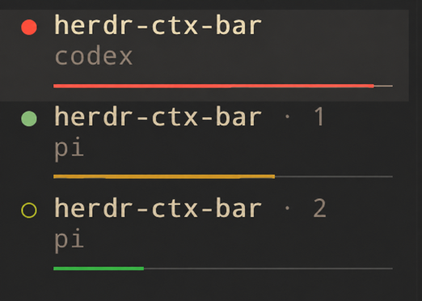
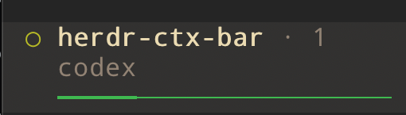
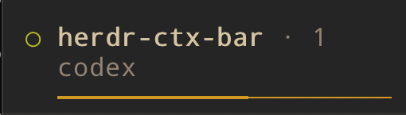
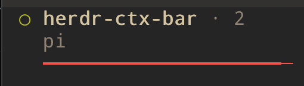

# Context Bar for Herdr

A lightweight, dependency-free [Herdr](https://herdr.dev) plugin that displays color-coded context-window usage for Codex, Claude Code, Pi, Hermes Agent, and OpenCode 2 directly in Herdr's Agents sidebar.

## Features

- Glanceable context-window usage without percentages or dashboards
- Green, yellow, and red bars that make high token usage easy to spot
- Responsive bar widths that follow the expanded Agents sidebar
- Local operation without provider API calls or external network requests
- Support for Codex, Claude Code, Pi, Hermes Agent, and OpenCode 2



Context Bar adds a thin progress line beneath every supported Agents sidebar entry:

- green below 50%
- yellow from 50% through 79%
- red at 80% and above

| Green: below 50% | Yellow: 50–79% | Red: 80% and above |
| --- | --- | --- |
|  |  |  |

That is the whole feature. There are no notifications, provider quotas, or extra dashboards.

## Requirements

- Herdr 0.8.0 or newer
- Python 3.10 or newer
- macOS or Linux

OpenCode support additionally requires Herdr 0.9.4 or newer with its current OpenCode integration, and a stable OpenCode 2 release from 2.0.32 onwards. OpenCode 3 is not supported. The baseline for OpenCode compatibility is 2.0.32; required API responses are validated on other 2.x releases.

## Installation

```sh
herdr plugin install pdalinis/herdr-ctx-bar
```

For local development:

```sh
herdr plugin link .
```

Install Herdr's agent integrations so panes are matched to the correct session instead of guessed by working directory:

```sh
herdr integration install codex
herdr integration install claude
herdr integration install pi
herdr integration install hermes
herdr integration install opencode
```

Configure the sidebar automatically:

```sh
herdr plugin action invoke herdr-ctx-bar.setup
herdr plugin log list --plugin herdr-ctx-bar
```

`setup` handles the safe common case automatically: it creates a timestamped backup, adds the Context Bar row when no custom Agent layout exists, validates the result, reloads Herdr, and starts the watcher. It is idempotent and can be run again after an upgrade.

If `[ui.sidebar.agents]` already contains a customized layout, `setup` leaves it untouched and prints the following section for you to merge. Add the final `$ctx_*` row to your existing `rows` array rather than declaring the table twice:

```toml
[ui.sidebar.agents]
row_gap = 0
rows = [
  ["state_icon", "machine", "workspace", "tab"],
  ["agent"],
  [
    { token = "$ctx_green", fg = "#3fb950" },
    { token = "$ctx_yellow", fg = "#d29922" },
    { token = "$ctx_red", fg = "#f85149" },
  ],
]
```

Herdr plugin v1 does not provide a declarative way for plugins to contribute sidebar rows. The explicit `setup` action is therefore required once after installation; Context Bar never edits UI configuration merely because it was installed or Herdr started.

## How it works

Context Bar runs one dependency-free Python watcher per Herdr server. It subscribes to pane lifecycle and agent-state events, reads local session records and configuration to calculate usage, and reports one colored metadata token per pane. OpenCode collection reads the existing loopback HTTP service and uses its local password when authentication is enabled. Context Bar does not contact provider APIs or send session data to external services.

The bar width follows the expanded sidebar. The watcher reads the live sidebar width from `pane.layout`, then redraws after divider changes. The heavy used segment (`━`) and thin remaining segment (`─`) form a narrow line inside one terminal row; Herdr plugin v1 cannot draw a literal native three-pixel element.

Data sources:

- Codex: the latest `last_token_usage` and `model_context_window` in its rollout JSONL.
- Claude Code: the latest non-sidechain assistant usage in its transcript, respecting compaction boundaries.
- Pi: the latest assistant context snapshot and Pi's local model catalog.
- Hermes: active message token counts in `state.db`, respecting compaction; messages without stored counts use Hermes' conventional characters-per-token estimate. The context window comes from Hermes configuration when present and otherwise follows Hermes' own 256K fallback.
- OpenCode 2: the latest eligible assistant usage snapshot from its existing local service, with the effective context limit for that assistant's provider, model and session location. The snapshot respects completed compaction and revert boundaries and includes input, output, reasoning and both cache counters.

If a session or context-window size cannot be identified safely, its bar is hidden rather than showing a misleading value.

### OpenCode 2

Install or repair Herdr's integration with `herdr integration install opencode`, then restart the OpenCode TUI so the integration can report its root session ID. Context Bar does not install a companion plugin or modify Herdr-managed integration files.

Context Bar reads `$XDG_STATE_HOME/opencode/service.json`, or `~/.local/state/opencode/service.json` when `XDG_STATE_HOME` is unset. The watcher uses its own environment, not the environment of each pane. To select a different registration, create `config.json` in the plugin configuration directory specified by `HERDR_PLUGIN_CONFIG_DIR`:

```json
{
  "opencode": {
    "service_file": "/absolute/path/to/service.json"
  }
}
```

Outside Herdr plugin context, the configuration path is `$XDG_CONFIG_HOME/herdr-ctx-bar/config.json`, falling back to `~/.config/herdr-ctx-bar/config.json`. The file is optional and is never created automatically. Restart the Context Bar daemon after changing it.

The configured service must be the service used by the supported panes. Context Bar requires an exact native session ID and never guesses by directory, title or activity. It measures the root session represented by Herdr's sidebar entry, even when the TUI is browsing a child. Remote services, multiple registrations in one watcher, Mini/headless clients and OpenCode 1 are outside this integration's scope.

Only loopback HTTP(S) endpoints are accepted. Collection ignores HTTP proxy environment variables, rejects redirects and verifies the service PID, version and readiness. The service registration may include a password, which is used only for HTTP Basic authentication as `opencode`. Passwords, message contents, raw service URLs and response bodies are excluded from diagnostics. Context Bar never starts, replaces, stops or migrates an OpenCode service and does not read its SQLite database.

OpenCode requests run in a two-worker pool, separately from sidebar resizing and existing agent collectors. Collection starts when a session is identified and repeats every 15 seconds. Requests have a two-second wall-clock limit; each collection has a five-second deadline, ten message pages and an eight-MiB response budget. Cold plugin activation or long reverted histories can exceed these limits and temporarily hide the bar. Previous samples expire after 20 seconds; a failed collection or session change clears the bar. Herdr also expires live OpenCode tokens after the remaining sample lifetime, including when the watcher stops.

The bar reports the latest measured context snapshot, not a prediction of the next request. Separate HTTP requests do not form an atomic snapshot, so a concurrent timeline change can become visible on the next sample. Effective model catalogs are refreshed each polling cycle.

## Usage and commands

```sh
herdr plugin action invoke herdr-ctx-bar.refresh
herdr plugin action invoke herdr-ctx-bar.status
herdr plugin action invoke herdr-ctx-bar.restart
```

Plugin command output is available through:

```sh
herdr plugin log list --plugin herdr-ctx-bar
```

## Troubleshooting and support

If a bar does not appear, first confirm that the matching Herdr agent integration is installed, then run:

```sh
herdr plugin action invoke herdr-ctx-bar.status
herdr plugin action invoke herdr-ctx-bar.refresh
herdr plugin log list --plugin herdr-ctx-bar
```

The bar is intentionally hidden when Context Bar cannot safely identify a session or its context-window size. For bugs, compatibility problems, or feature requests, [open a GitHub issue](https://github.com/pdalinis/herdr-ctx-bar/issues).

For OpenCode, `status` also prints the daemon's latest per-pane availability reason and sample age. Diagnostics are local, socket-scoped snapshots, not a history; they can be stale after a daemon stops. Common reasons include `service_unavailable`, `session_unavailable`, `authentication_failed`, `missing_model_limit`, `no_eligible_usage` and `collection_budget`. A new session or completed compaction may have no eligible usage until the next assistant snapshot. A manual `refresh` waits for bounded OpenCode collection and exits nonzero when usage is unavailable or collection is incomplete; other agents are refreshed before waiting.

## Development

### Screenshot previews

You do not need to consume a real agent context window to test the bar. Focus the
pane you want to preview, then invoke one of the temporary demo states:

```sh
herdr plugin action invoke herdr-ctx-bar.demo-green
herdr plugin action invoke herdr-ctx-bar.demo-yellow
herdr plugin action invoke herdr-ctx-bar.demo-red
herdr plugin action invoke herdr-ctx-bar.demo-clear
```

The presets display 25%, 65%, and 95% usage. A preview affects only the focused
pane, expires automatically after five minutes, and never modifies the agent's
session or context. `demo-clear` performs a bounded live refresh. Because
the CLI uses Herdr's currently focused pane, focus the intended agent before
running each command.

After changing the manifest, relink before using these actions:

```sh
herdr plugin link .
```

### Checks

```sh
python3 -m unittest discover -s tests -v
python3 -m py_compile bin/ctx_bar.py bin/opencode_v2.py
ruff check bin tests
ruff format --check bin tests
herdr plugin link .
```

Manifest changes require relinking the plugin. Python changes are picked up after `herdr-ctx-bar.restart`.

## License

[MIT](LICENSE)
